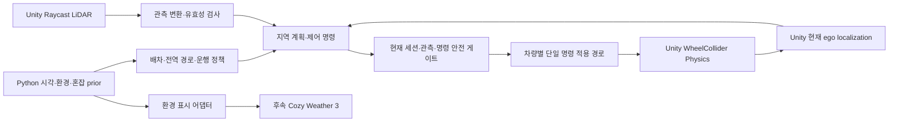

# 10/28 피드백 반영 및 다음 주차 통합 시연 계획

작성일: 2026-10-28 · 상태: 기획안 / 구현·검증 완료 보고서 아님

조사 기준: 현재 `codex/week8-integration` 작업 폴더의 `VERSION=0.5.3.0`, 마지막 커밋 `020f6317` (`v0.5.2.0`). 0.5.3.0은 진행 중인 작업 값이며 확정 릴리스로 판단하지 않는다. 이 문서 작성에서는 코드·씬·에셋·통신 계약·버전·기존 충돌을 변경하지 않고 커밋/머지도 수행하지 않는다.

## 1. 다음 주차에 보여줄 결과

목표는 기능별 독립 시연을 나열하는 데서 벗어나, **같은 캠퍼스·같은 서버 세션에서 요청 → 배차 → 센서에 따른 주행/정지 → 재연결 후 현재 위치 확인 → 운송 재개**가 이어지는 통합 시연이다.

| 받은 피드백 | 반영 방향 | 시연에서 확인할 장면 |
|---|---|---|
| 다음 주차에 완성도 있는 통합 | 기존 3대 운송·PC 관제를 중심으로 LiDAR와 통신 제동을 연결 | 서로 다른 요청, 차량별 운행 구간·경로 선, 관측에 따른 정지와 재출발 |
| 비·눈 등 날씨 반영 | 환경 상태·운행 정책·시각 효과를 분리하고 후속 Cozy 어댑터로 연결 | 동일 조건의 맑음/비/눈 정책 차이와 적용 상태 표시 |
| 재연결 시 현재 위치 연동 | 새 연결에서 실제 현재 ego와 새로운 센서 관측을 재전송하고 서버와 임무 상태를 맞춤 | 옛 위치로 복귀하지 않고, 현재 위치를 확인한 뒤 제동 해제/경로 재계획 |
| 실제 수업·식사 시간대의 밀집 | 공식 운영 자료와 현장 관찰을 구분한 시간·장소별 이동 수요/혼잡 prior | 수업 교체 시간의 건물 간 이동, 식사 시간의 식당 방향 이동과 비룡플라자 앞 우회 |

다음 주차 필수 범위는 기존 운송 유지, 제어권 단일화, 센서 기반 정지, 현재 위치 재동기화, 근거가 표시된 혼잡 시나리오다. Cozy의 실제 비·눈 렌더링은 사용자가 설치한 뒤의 확장이다. 설치되지 않은 효과를 시연 완료로 보고하지 않는다.

## 2. 현재 기준선과 통합에서 주의할 차이

| 영역 | 확인한 현재 상태 | 다음 작업 |
|---|---|---|
| 기존 캠퍼스 운송 | `UnityAutonomousClient`와 `/v1/demo/unity/vehicles/{vehicle_id}/control`로 WheelCollider 운행. 3대 배차·PC 경로 표시가 있음 | 주행 가능한 기준선으로 보존 |
| 팀 LiDAR | 독립 `LidarSensorDemo`, scan당 4,680 rays, 재사용 관측 버퍼·디버그 표시가 있음 | 캠퍼스 차량에 연결할 관측 변환·유효성·부하 검증 |
| 통신 복구/제동 | `TransportSafetyGate`, WebSocket data source, bridge 및 독립 정지 gateway가 있음 | 현재 캠퍼스의 운행 입력과 연결하고 중복 제어 제거 |
| 통신 계약 | 기존 물리 주행 protocol 4와 가져온 정지 전용 v4는 서로 다른 계약 | 이름의 숫자만 보고 공용 DTO/API로 취급하지 않음 |
| 밀집·날씨 | 이번 조사에서 현재 운행까지 연결된 통합 경로를 확인하지 못함 | 계획·독립 시험·실제 연결의 완료 수준을 따로 기록 |
| Git | staged/unstaged/untracked 통합 파일이 함께 있고 `Docs/implementation_status.md`가 unmerged 상태 | 작업 보존과 충돌 해소를 통합의 첫 단계로 수행 |

과거 개별 브랜치의 Python/PlayMode 통과 수는 현재 통합 브랜치의 통과 수로 합산하지 않는다. 특히 기존 v3 서버를 요구하는 시험과 현재 캠퍼스 제어 시험을 구분한다.

근거: [8주차 통합](WEEK8_INTEGRATION.md), [출처 manifest](week8_import_manifest.json), [LiDAR](lidar_sensor.md), [통신 복구 기록](transport_week8_progress.md), [팀 차량 제동](team_vehicle_transport_integration.md).

## 3. 머지 및 런타임 통합 계획

### 3.1 소스 이력을 보존하는 순서

1. **현재 작업 보존:** staged 변경, unstaged 변경, untracked 파일, `.meta`와 씬을 각각 보관한다. tracked diff만 저장하고 새 프리팹/스크립트를 누락하지 않는다. 진행 중인 Git 작업의 종류와 index 충돌 상태도 기록한다.
2. **기준선 고정:** `020f6317`의 캠퍼스 운송을 비교 기준으로 삼되, 현재 통합 폴더의 후속 수정도 보존한다. `week8_import_manifest.json`의 실제 적용 내역과 Git diff를 대조한다. 원격 최신 상태는 구현 착수 시 fetch 후 다시 확인한다.
3. **기존 충돌 해소:** `Docs/implementation_status.md` 양쪽 기록을 남기고 소스 통합과 런타임 검증을 분리해 정리한다. 충돌 마커 제거만으로 병합 완료를 판정하지 않는다.
4. **LiDAR 소스 반영 확인:** 문서에 기록된 `53bb8ae6`/`origin/vehicle-simulation`의 센서·독립 시연을 유지한다. 기존 씬·공유 차량 원본을 통째로 교체하지 않는다.
5. **통신 코드 선별 반영 확인:** 문서상의 `05388eb0`, `30d2614f`, `78500582`에서 필요한 gate/DTO/bridge와 의존성을 대조한다. `algorithms`의 과거 합성 서버 전체를 현재 Python 서비스 위에 덮어쓰지 않는다. 이미 반영된 커밋을 중복 cherry-pick하지 않는다.
6. **런타임 어댑터 연결:** 아래 제어·센서·복구 경계를 명시적으로 연결한다. 소스가 같은 브랜치에 있다는 것과 실제 연결되었다는 것을 구분한다.
7. **통합 검사 후 릴리스:** 동일 Editor에서 컴파일·회귀·실제 시나리오를 확인하고 VERSION, API/package, Unity, 현재 문서, 지도 빌드 정보를 동기화한다. 커밋마다 새 네 자리 버전과 본문·주석 태그를 사용한다. 현재 미확정 버전/태그를 임의로 재사용하지 않는다.

향후 후속 브랜치는 `codex/week9-feedback` 같은 별도 통합 브랜치를 제안한다. 현재 작업 보존·진행 중 병합 정리가 먼저이며, 본 기획에서는 새 브랜치나 worktree를 만들지 않는다. `main` 반영은 아래 인수 조건을 충족한 변경 묶음으로 검토하고 원본 팀 브랜치를 이동·강제 덮어쓰기하지 않는다.

### 3.2 런타임 연결에서 지킬 경계



- **제어권:** 차량마다 `SetDriveCommand`로 이어지는 경로는 하나만 둔다. 기존 `UnityAutonomousClient`를 당장 제거하기보다 그 명령 적용 앞에 gate를 연결하는 방식을 먼저 검증한다. 별도 actuator/route follower/제동 bridge가 동시에 운행 토크를 덮어쓰지 않도록 연결표를 작성한다. 제동은 단일 적용 경로에서 최우선으로 병합한다.
- **단위:** 서버의 m/s·rad와 차량 API의 km/h·rad를 경계에서 한 번만 변환한다. 조향각과 yaw rate를 같은 값으로 전달하지 않는다.
- **센서:** Unity raw hit를 차량·sensor ID, 관측 tick/시각, ego pose version, local 좌표로 변환한다. 가변 버퍼는 scan 완료 시 일관된 frame으로 복사/소유권 이전하고 송신 중 덮어쓰지 않는다.
- **크기 차이:** LiDAR 4,680 rays와 정지 gateway 초안의 최대 64 hits는 그대로 연결할 수 없다. 제어용 sector 요약과 PC용 raw debug 채널을 구분한다. 요약 시 구역별 최근접 hit와 관측 범위/유효성을 보존하며, 단순히 가까운 64개만 골라 나머지를 안전한 빈 공간으로 만들지 않는다. 기존 제어 계약의 전방 관측 범위에 맞는 어댑터부터 검증한다.
- **권위:** Python은 타 보행자/차량의 실제 Transform이나 미래 경로를 주행 판단 입력으로 받지 않는다. Ground Truth 화면/오프라인 평가 로그와 자율주행 관측 채널을 분리한다.
- **회귀:** 독립 LiDAR 씬은 계속 실행 가능하게 두고, PC 캠퍼스에는 그 씬 전용 수동 운전 코드를 활성화하지 않는다. Additive 구조와 기존 GUID/차량 형상도 보존한다.

## 4. 끊김 → 현재 위치 재동기화 → 재출발

### 4.1 먼저 구분할 세 상황

| 상황 | 복구 원칙 |
|---|---|
| 같은 Python run으로 네트워크만 재연결 | 기존 요청·탑승/적재 단계는 보존하고 새 현재 ego로 남은 임무를 재검사 |
| Python 서버 재시작으로 run이 변경 | 위치 재전송만으로 잃어버린 서비스 상태를 복원할 수 없음. 영속 상태가 없다면 자동 재배차/출발 금지, 임무 확인 상태 유지 |
| Unity world까지 재시작 | 실제 시뮬레이션 위치가 새로 생성된 세션으로 구분. 저장된 과거 pose를 실제 현재 위치라고 보내지 않음 |

### 4.2 제안 복구 상태 흐름

```text
DRIVING
  → DISCONNECTED / BRAKE_LOCKED
  → CONNECTING
  → SESSION_VERIFIED
  → SERVICE_SNAPSHOT_CONFIRMED
  → CURRENT_EGO_ACCEPTED
  → FRESH_SENSOR_CONFIRMED
  → MISSION_RECONCILED
  → NEW_COMMAND_ACCEPTED
  → READY_TO_RESUME
```

상태명과 필드는 제안이며 현재 API에 이미 존재한다고 가정하지 않는다. `TransportSafetyGate`의 새 session → snapshot → 새 관측 → 유효 명령 순서를 현재 운행 흐름에 적용할 기준이다.

1. **단절 감지:** 실제 경과 시간 기반 watchdog으로 새 토크를 차단한다. TCP 연결 상태만 보지 않고 관측/명령 만료, 큐 overflow도 검사한다. UI에는 연결 끊김과 제동 잠금을 표시한다.
2. **새 세션 확인:** 차량 소유권, run, map hash/좌표 계약, 지원 protocol을 검사한다. 옛 소켓 callback·명령 큐를 폐기한다. sequence 초기화는 새 세션/epoch 안에서만 허용한다.
3. **서비스 snapshot:** 요청/차량 임무/탑승 또는 적재 상태를 서버에서 다시 받는다. 이 snapshot은 서비스 상태이며 Unity 차량 pose를 과거 서버 pose로 강제 이동시키는 명령이 아니다.
4. **현재 위치 업로드:** 새 연결 성립 이후 Unity main thread에서 ego pose·heading·signed speed/velocity를 새로 읽어 새 pose version/tick과 보낸다. 수신 확인된 `session/epoch + pose_version`을 이후 센서 frame과 연결한다. 네트워크 재송신 큐의 예전 snapshot을 그대로 보내지 않는다.
5. **센서 갱신:** 확인된 ego와 연결된 최신 유효 scan을 보낸다. 센서가 invalid/stale이면 제동을 유지한다. raw hit overflow나 frame 유실도 빈 공간으로 해석하지 않는다.
6. **임무 조정:** 같은 run이면 기존 request ID와 승하차 단계를 대조하고 현재 위치에서 남은 경로를 재계획한다. 완료·취소 요청을 다시 실행하거나 탑승한 요청을 새 요청처럼 배차하지 않는다. 충전·복귀 상태도 함께 확인한다.
7. **재개:** 새 명령의 세션·차량·참조 pose/scan·sequence·만료를 검사하고 마지막 단계에서만 gate를 해제한다. 다음 주 시연에서는 운영자의 명시적 재개를 기본으로 제안한다. 자동 재개는 같은 run의 임무·최신 관측·경로가 모두 검증된 별도 정책으로만 후속 검토한다.

새 계약의 시각/만료 검사는 합의된 simulation time과 로컬 monotonic watchdog을 분리한다. 서로 다른 기기의 wall clock 값을 그대로 빼서 지연을 판정하지 않는다. 차체가 실제 감속한 거리/시간과 단순 제동 요청 이벤트도 따로 측정한다.

재연결 검증은 우선 V01 한 대에서 수행하고 V02/V03 동시 재접속·한 차량만 단절되는 조건으로 확장한다. 모바일은 승객 요청 snapshot을 복구하는 역할이며 차량 ego를 보고할 권한을 갖지 않는다.

## 5. 비·눈 기획과 Cozy Weather 3 후속 연결

### 5.1 표시와 운행 정책을 연결하되 권위를 분리

환경의 단일 기준은 **Python 시나리오의 시간·환경 상태**로 제안한다. 맑음/비/눈을 선택하면 같은 환경 revision을 Unity Physics 정책, 센서 모사, 운행 정책, PC/Mobile 표시에 적용한다. Cozy는 그 상태를 하늘·강수 등으로 표현하는 어댑터다. 날씨 이미지 변화만으로 센서/마찰/안전 정책이 자동 변경된다고 가정하지 않는다.

Cozy UI에서 날씨를 바꾸는 기능이 필요하면 서버로 변경 요청을 보내고 승인된 상태를 다시 적용한다. Cozy의 자체 랜덤 날씨/시간과 Python 혼잡 시각이 각각 독립 진행하지 않도록 한다. 후속 적용 시 불필요한 자동 진행을 끄거나 서버 시각에 맞추는 지원 방식을 설치 버전에서 확인한다.

| 상태 | 시각 표현 | Python 계획/안전 | Unity Physics·센서 |
|---|---|---|---|
| 맑음 | 현재 렌더 기준선 | 기존 제한과 센서 기반 제어 | 비교용 기준 프로필 |
| 비 | 비·흐린 하늘·젖은 표현은 설치 후 | 보수적인 속도 상한/제동 여유·ETA 보정 검토 | 젖은 노면용 합성 grip과 센서 유효 범위/누락 모사 실험 |
| 눈 | 눈·시정 표현은 설치 후 | 더 보수적인 프로필, 불충분한 관측/노면 조건에서는 대기·운행 제한 | 합성 저마찰·시정 프로필 및 제동 검사 |

노면 마찰, 감속 성능, 시정, 센서 저하량은 아직 확정하지 않는다. 비가 온다는 이유만으로 특정 수치나 실제 장비 성능을 만들어 넣지 않는다. 먼저 합성 프로필임을 표시하고 같은 경로·차량으로 제동 실험한 뒤 설정 범위를 정한다. 비/눈이 멎어도 노면 상태는 즉시 건조로 바뀌지 않게 강수와 노면 상태를 별도 필드로 둔다.

운행 정책은 `min(도로 제한, 곡률 제한, 환경 제한, 센서 안전 제한, 도착 제한)`을 적용하는 방향으로 설계한다. 센서 기반 감속/정지는 날씨 연출보다 우선한다. 제동 가능 감속도를 사용하는 정지거리 모델은 Physics 결과와 대조하며, 환경값 누락·유효하지 않은 감속도는 맑음 기본값으로 숨기지 않고 안전한 대기/제한 사유로 표시한다. 급한 승객·마감 요청도 환경 제한을 우회하지 않는다.

### 5.2 제안 환경 데이터와 어댑터

| 정보 | 목적 |
|---|---|
| `environment_revision`, `effective_tick`, `profile_id` | 같은 적용 상태와 전환 시각 추적 |
| `precipitation_kind`, `intensity_level`, `surface_state` | 강수와 남아 있는 젖음/눈 상태 분리 |
| `visibility_m`, `speed_cap_mps`, `braking_profile_id` | 정책 입력; 합성/검증 여부와 함께 사용 |
| `sensor_degradation_profile_id`, `seed` | 모사 저하의 재현성; 실제 센서 성능과 구분 |
| `source`, `verification`, `config_hash` | 수동 시나리오/실측/가정 출처와 변경 이력 |

필드 이름·추가 schema 번호는 구현 전 계약 검토 대상이다. 새로운 환경 계약을 프로젝트 버전이나 기존 지도 schema에 일괄 치환하지 않는다.

Cozy 미설치 상태에서는 환경 프로필 선택과 상태/정책 확인만 가능하도록 설계한다. 설치 후 `CozyWeatherPresentationAdapter` 같은 선택 어셈블리로 시각화를 연결해 SDK가 없더라도 기존 PC/Mobile 빌드가 컴파일되게 한다. vendor 원본 소스·공유 재질을 직접 수정하지 않고 프로젝트용 설정/프리셋을 사용한다.

공식 문서는 모듈과 날씨 이벤트 훅을 제공하는 구조를 설명한다. 이는 어댑터 연결 근거이며, 설치할 Cozy 3 버전의 실제 API·Unity 6000.3.21f1·현재 렌더 파이프라인 호환성을 보장하지 않는다. 설치 후 라이선스/필수 의존성·셰이더·카메라·조명 충돌부터 확인한다. [공식 Modules](https://distant-lands.gitbook.io/cozy-stylized-weather-documentation/how-it-works/modules), [공식 Events Module](https://distant-lands.gitbook.io/cozy-stylized-weather-documentation/how-it-works/modules/events-module).

### 5.3 성능과 표현 품질

- PC에는 기존 표현 품질을 유지하는 별도 프리셋을 둔다. 모바일은 강수 입자 수·표시 거리·반사/후처리 품질을 조정하되 같은 환경 상태와 운행 제한을 표시한다.
- 시각 효과를 줄이거나 숨겨도 Physics·센서 관측·혼잡/안전 계산은 생략하지 않는다. 비 입자 GameObject를 실제 장애물 Collider로 대량 생성하지 않는다.
- 같은 카메라 경로에서 맑음/비/눈의 FPS·프레임 시간 p95, 배치 수, 메모리, 센서/제어 loop 시간을 측정한다. 장비·해상도·품질을 함께 기록한다. GPU Instancing/LOD/Static Batching은 대상별 적합성을 확인하며 플래그만으로 최적화 완료를 선언하지 않는다.

## 6. 수업·식사 시간을 반영한 캠퍼스 밀집

### 6.1 실제 자료와 합성 수요를 구분

`09:00 / 10:30 / 12:00 / 13:30 / 15:00` 전후의 혼잡과 비룡플라자 앞 우회 요구는 유지한다. 이 시각은 사용자 관찰 기반 필수 시나리오이며 모든 학과의 공식 교시나 실측 밀도 통계로 확정하지 않는다.

이번 조사에서는 최신 인하대학교 공식 교시표·식당 운영시간을 확정할 원문을 확보하지 못했다. 다른 대학이나 인하공전의 시간표를 인하대 자료로 대체하지 않는다. 다음 구현 착수 전 아래 자료를 확보해 profile의 근거와 적용 학기를 고정한다.

| 필요한 자료 | 확보/확인 방법 | 사용 범위 |
|---|---|---|
| 해당 학기 강의 교시·시작/종료 시각 | 인하대 공식 학사/수강 자료, 사용자가 제공한 확인 자료와 대조 | 이동이 증가하는 시간 구간 후보 |
| 강의동별 수업 집중 | 개인정보 없는 건물 단위 집계·공개 강의 정보 | 출발/도착 건물군별 상대 수요 |
| 식당 위치·운영시간 | 공식 캠퍼스 시설/당일 운영 안내와 현장 대조 | 식사 목적지와 접근 가능한 보행 연결 |
| 점심 이동과 비룡플라자 앞 체류 | 구역별 5분 단위 익명 통행·체류 관찰을 제안; 방향·관찰 일자·날씨도 기록 | prior의 상승/하강 시점과 구역 가중치 보정 |
| 요일·휴강·시험·방학·행사 | 해당 날짜의 운영 정보 | 평일 수업일과 다른 profile 선택 |

식사 혼잡 조사 후보는 우선 11:30~13:30으로 제안하되, 공식 운영시간·최고 혼잡 시간으로 표시하지 않는다. 관찰 결과에 따라 바꾼다. 단순히 12시에 캠퍼스 전체 인원을 동시에 늘리는 방식은 피한다. 실명·학번·개인 시간표/동선을 수집하지 않는다.

### 6.2 시간과 공간을 함께 모델링

1. 강의 시작 전에는 문·역·기숙사/이전 강의동 → 강의동, 종료 직후에는 강의동 → 다음 강의동의 OD(출발/도착) 흐름을 생성한다.
2. 식사 시간에는 강의동 → 확인된 식사 시설의 흐름을 추가하고, 식사 후 강의동으로 돌아오는 지연 분포를 둔다. 식사 시간에도 수업이 있는 인원을 일괄 이동시키지 않는다.
3. 비룡플라자 앞은 통과 흐름과 체류 인원을 구분한다. 광장 중앙을 차량 목적지로 만들거나 미검증 보도를 차량 경로로 추가하지 않는다.
4. 지점별 혼잡은 갑자기 토글하기보다 검증한 시간 구간에서 증가·정점·감소하도록 한다. 관찰 전 구간 폭/규모는 합성 가정으로 표시한다.
5. 보행자는 Unity에서 실제로 생성·이동·정지한다. Python은 시간표 기반 prior로 전역 비용/우회 정책을 세우되, 현재 앞을 가로막는 사람의 위치는 센서로만 판단한다. Unity 전체 밀도 Ground Truth는 평가/관제용으로만 별도 기록한다.
6. 비가 오면 식사/보행 경로 선호가 바뀔 가능성은 후속 가설로 둔다. 검증 없이 모든 사람을 차량 도로로 몰거나 접근성 제약을 완화하지 않는다.

제안 데이터는 `요일/학기/수업일 여부 + 구역/건물군 + 시간 구간 + OD 가중치 + 체류/이동 분포 + 출처/관찰 수 + 검증 상태`다. 향후 파일 위치는 `configs/crowd_profiles/`, `scenarios/`를 제안하며 현재 이미 존재하는 파일로 간주하지 않는다.

### 6.3 비교 방법과 UI

- 같은 초기 상태·요청·보행 시나리오·seed로 Baseline과 개선 알고리즘을 독립 실행한다. A*/Dijkstra는 같은 가중치를 사용해 비용/확장 노드/시간을 비교하고, 밀도 우회 정책 비교는 별도 축으로 둔다.
- 고정 seed만 같다고 실시간 물리 결과가 완전히 동일하다고 가정하지 않는다. 프레임·스캔·적용 tick을 로그에 남기고 반복 실행한다.
- 요청 대기/완료/지각, 경로 비용·거리, 감속·정지·재출발, 혼잡 구간 체류, 접촉 사건을 기록한다. 가상 운송 ETA와 Unity 실측 운송 시간을 구분한다.
- PC에는 Asia/Seoul 시각, 수업/식사 profile, 예상 혼잡과 센서 관측, 적용 우회 사유를 구분해 표시한다. 혼잡 정도를 실측처럼 보이는 수치로 꾸미지 않는다.
- 물리 운행은 1배속으로 관찰한다. 아침/점심 시나리오는 정차·reset 경계에서 시작 시각을 달리한 독립 run으로 준비해 긴 실제 대기 없이 비교한다. 주행 중 시간을 점프해 센서 age·명령 만료 검사를 깨뜨리지 않는다.

## 7. 다음 주차 실행 순서와 머지 게이트

시연일은 미정이다. 아래는 착수일 기준 작업일 순서이며, 예를 들어 11/2 착수라면 해당 주차에 맞춰 배치한다. 특정 일자에 완료를 보장하는 일정은 아니다.

| 순서 | 작업 묶음 / 주 담당 역할 | 완료 게이트 |
|---|---|---|
| D0 | 통합 담당: 작업 백업·충돌 정리·출처/DTO/명령 소유권 목록 | unmerged 0, 원본 보존, 현재 코드 컴파일·기준선 운행 결과 확보 |
| D1 | 센서 담당 + Python 담당: V01 LiDAR 관측 어댑터와 정지 | 동적 객체 GT 전달 없이 관측 생성→수신→제동 확인; invalid/stale/overflow에서는 정지 |
| D2 | 통신 담당 + 차량 담당: 새 세션·현재 위치 재동기화 | 단절 제동·현재 ego ACK·옛 명령 거부·임무 중복 없음; 실제 제동 거리 측정 |
| D3 | 지도/시나리오 담당: 수업/식사 근거 수집·prior/우회 | 시설·시각 출처 표, 비룡플라자 진입 edge/대기점 확인, 독립 run 비교 |
| D4 | 정책/관제 담당: 날씨 profile과 적용 상태, 통합 HUD | Cozy 없이 동작하는 정책 경계 확인; 기존 3대 UI/배차/경로 선택 회귀 |
| D5 | 통합 담당: 세 차량 시나리오·회귀·영상/발표 정리 | 아래 인수 조건과 실패/한계 표, 최종 run manifest·로그·영상 |

서로 다른 작업의 공통 DTO/API 수정은 먼저 계약을 고정한 뒤 진행한다. 센서가 미완성이어도 가짜 최신/clear 관측을 주입해 D2를 통과시키지 않는다. 성능/관측 지연 문제는 해상도·전송량을 명시적으로 튜닝하고 최신성 검사를 무조건 완화하지 않는다.

### 제안 인수 조건

| ID | 재현할 시험 | 판정 근거 |
|---|---|---|
| INT-01 | 세 차량에 서로 다른 요청 배차 | 실제 차량별 요청·pose·단계·경로 변화, 중복 차량 소유권/토크 입력 없음 |
| INT-02 | V01 전방에 Unity 보행자/장애물이 진입 | 센서 관측으로 감속·정지; 장애물 실제 Transform을 Python에 직접 전달하지 않음 |
| REC-01 | 움직이던 한 차량의 통신만 끊고 재연결 | watchdog 제동, 새 현재 ego/scan 참조, 재개 전 위치 ACK와 운영자 확인; teleport 없음 |
| REC-02 | 옛 command/ego replay, 지도 불일치, invalid scan | 명시적 거부 사유와 제동 유지; 옛 큐가 새 세션에 영향 없음 |
| REC-03 | 서버 재시작, 운송 중 요청 존재 | 새 run 구분, 서비스 상태 복원 불가 시 자동 출발 금지·확인 필요 표시 |
| CRD-01 | 수업 교체 시간과 한산한 시간 비교 | 근거 있는 건물별 흐름, 동일 입력 비교 결과, 합성/관찰값 표시 |
| ZON-01 | 비룡플라자 앞 혼잡 prior 또는 유효한 로컬 관측 | 검증된 우회 또는 경계 밖 대기; 시간 민감·이동지원 요청도 제약 준수 |
| WEA-01 | 같은 경로를 맑음/비/눈 profile로 실행 | 적용 revision 일치, 정책 차이·제동 결과; 실제 렌더 미설치 여부 명시 |
| REG-01 | 전체 Python·관련 C#·Editor/PlayMode·PC 화면 회귀 | 실행 소스/버전·명령·원본 결과 보관; v3 전용 시험 제외/실패도 명시 |

현재 교차로 경합·좁은 구간 다중 차량 조정이 미완료인 상태를 숨기지 않는다. 다음 시연 경로는 충돌 위험이 낮은 조합부터 선택하고 실제 접촉이 나면 실패 사례로 기록한다. 충돌 비활성화나 타 차량 Ground Truth 주입으로 성공처럼 만들지 않는다.

시연은 기존 운송/전경 → 센서 정지 → 단절/재동기화 → 수업·식사 우회 비교 → 날씨 정책/Cozy 확장 설명 순서로 구성한다. 한 run의 정상 완료와 별도 run의 장애 주입·서버 재시작 시험을 섞어서 연속 성공처럼 편집하지 않는다.

## 8. 다음 구현 전에 확정할 항목

- 최신 공식 학기/교시·식당 운영 자료와 관찰 구역/일자. 미확보 항목은 미검증으로 남긴다.
- 날씨별 합성 속도/제동/센서 모사 profile와 검증 방법. 수치 확정은 실제 시험 후 진행한다.
- Cozy Weather 3 설치 버전·렌더 파이프라인 호환성·라이선스/배포 범위 및 PC/Mobile 품질 프리셋.
- 현재 제어 protocol과 새로운 복구 metadata를 연결할 버전 협상/호환 어댑터. STOP-only gateway를 운행 서버로 승격하는 것은 별도 설계로 판단한다.
- 서버 재시작 후 요청/탑승 상태를 복원할 저장 방식. 다음 주 범위에서 제외하면 자동 재개 불가를 UI/발표에 명확히 남긴다.
- 통합 시연 날짜와 역할별 담당 확정, 최종 코드/설정/지도 hash 및 장비·해상도 기록.

이 계획의 완료는 문서 작성까지다. 머지 충돌 해소, 새 API 구현, Cozy 설치, 혼잡 자료 검증 및 인수 시험 실행은 다음 구현 작업이다.
