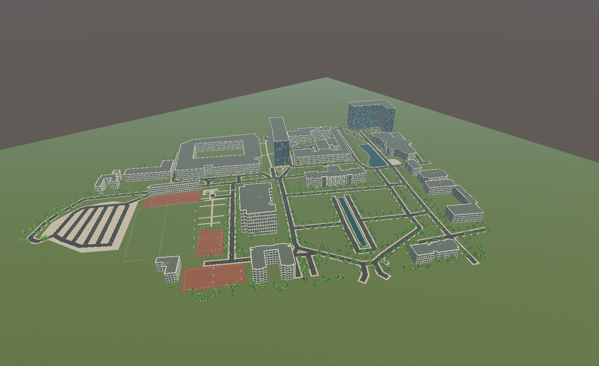

# Inha Mobil
인하대학교 교내 자율주행 운송 서비스 / Inha University Autonomous Campus Mobility Service

Python 기본 운행: 기존 **OSM + Unity 도로 중심선·출입구 후보**를 사용한 지도에서 차량 **3대**의 **요청·차량 FIFO → Dijkstra 픽업/운송/복귀 → 복귀·충전 후 재배차**를 제공한다. 배터리 소모와 왕복 후 15% 예비량 검사를 포함한다. 기본 배치는 **V01 정문·V02 후문·V03 운동장 옆 주차장**이며 각 차량은 자기 거점으로 복귀·충전한다. 도로 형상은 원본 기반이며 속도·승하차 거점·통행은 미검증인 가상 시간 실행이다. 기준속도 30km/h의 v2 지도에서 왕복 가능한 도로 Stop 후보는 14개이다. V01 물리 자동 경로 운행은 아래와 같이 별도로 연결했다. 실행·파일 구조·시간 예제는 [서버 안내](Docs/server_m0.md)를 참고한다.

프로젝트 버전: **0.5.2.0**. Unity 차량 3대의 관측 기반 물리 배차·회차·승하차·차고 복귀와 합성 배터리/충전을 연결했습니다. 정류장·허브의 Editor 위치 편집과 서버 지도 동기화, 도로 연결·표면 보정을 포함합니다. 기존 가상 시연과 물리 실행은 구분하며, 전체 거점 운송·다중 차량 충돌 조정·모바일 실기기·성능 검증은 완료되지 않았습니다. 상세와 검증 근거는 `Docs/implementation_status.md`를 따릅니다. 관제 차량 카드에 운행 구간을 표시하고 A*/Dijkstra 선택 및 차량별 전경 경로 선을 지원합니다. 다중 요청 후보 재평가를 보완했고 합성 충전 출력을 20 kW로 설정했습니다. 실제 PC 화면의 20초·720p 영상은 `artifacts/pc-client-video/Inha-Mobil-PC-20s.mp4`에 있습니다.

[통합 개발 규칙](AGENTS.md), [구현 현황](Docs/implementation_status.md), [물리 자동 운행](Docs/UNITY_PHYSICS_AUTODRIVE.md), [차로 모델과 가정](Docs/LANE_MODEL.md), [지도 출처](Docs/MapResearch/PLAN.md)를 참고하세요.

## PC 클라이언트 시작

`PC_Bootstrap`에서 Play하면 Python 서버를 자동 실행/재사용하고 기존 `CampusWorld → CampusTerrain` 및 `PC_Operator`를 Additive로 불러온다. 별도 서버 실행 명령은 필요 없다. PC에서 V01 목적 거점을 선택해 자동 운행한다. [PC 자동 실행·실제 세션 검증·Windows bundle](Docs/PC_SERVER_STARTUP.md)을 참고한다.

## CampusTerrain 서버 지도

기존 CampusTerrain에서 웹과 같은 노드 187개·허브 3개·Stop 후보 14개를 확인한다. Play 시 같은 웹 서버의 지도와 run/time 상태를 읽으며 차량 조작은 아직 연결하지 않는다. [실행·지도 갱신·검증 범위](Docs/CAMPUS_SERVER_MAP.md)를 따른다.

## 배차 정책 비교

FIFO 기준선과 Greedy/Hungarian을 웹에서 선택한다. 같은 초기 차량/배터리와 요청의 독립 비교, 반복 측정, 요청별 배정과 JSON 저장을 제공한다. [배차 비교 안내](Docs/DISPATCH_COMPARISON.md)에서 비용/제약/재현 방법을 확인한다. 전체 backend 187개 테스트를 통과했으며 실제 차량 운행 성능이 아닌 가상 시간 실험이다.

## 센서 기반 지역 회피

센서 관측 검증·TTC/정지거리 판단·자체 RRT 정적 우회 후보를 추가했다. 신규 24개 테스트와 합성 SVG/JSON을 제공한다. 별도 웹 RRT/TTC 합성 시각화 탭이 있으며 Unity SensorRig·실제 제어·캠퍼스 차량 회피 연결은 아직 없고 [구현 범위와 연결 계획](Docs/LOCAL_AVOIDANCE.md)을 따른다.

## 웹 2D 시연

```powershell
.\scripts\start_web_demo.ps1
```

브라우저에서 http://127.0.0.1:8765/demo/ 를 연다. 캐시 OSM 건물·도로와 차량 3대, 요청·차량 FIFO, A*/Dijkstra 경로, 배터리·충전을 확인할 수 있다. 기본 A*, 노드 보기와 선택 구간 탐색 비교를 제공한다. 외부 타일/CDN/API 키 없이 작동하며 1~300배속·일시정지·초기화와 시연 시나리오를 제공한다. [실행 준비·시연 순서](Docs/WEB_DEMO.md)를 따른다.

## Unity 프로젝트 실행

1. Git LFS를 설치한 뒤 이 저장소를 복제합니다. 기존 복제본에서는 `git lfs pull`을 실행하세요.
2. Unity Hub에서 저장소 폴더를 추가하고 **Unity 6000.3.21f1**로 엽니다.
3. `Assets/InhaCampus/InhaCampus.unity`를 엽니다.

현재 구현은 인하대학교 환경 맵입니다. 플레이어, 차량, 사람, UI는 포함하지 않습니다.
다른 씬에서 사용할 수 있는 환경 프리팹은 `Assets/InhaCampus/InhaCampusMap.prefab`입니다.

건물 및 도로 배치는 실제 지도 좌표를 사용하며, 외관·높이·수목은 근사 모델입니다. 지형 고저차는 미반영입니다.
[맵 구성, 검증 및 재생성 안내](Docs/AI/InhaCampus.md)를 참고하세요.



## 데이터 출처

코드에는 저장소의 MIT 라이선스가 적용됩니다. OpenStreetMap 지도 데이터 및 파생 지리 데이터에는 별도로 **ODbL 1.0**이 적용됩니다.
© [OpenStreetMap contributors](https://www.openstreetmap.org/copyright).
[지도 데이터 출처](Assets/InhaCampus/Source/ATTRIBUTION.txt)를 유지해 주세요.
