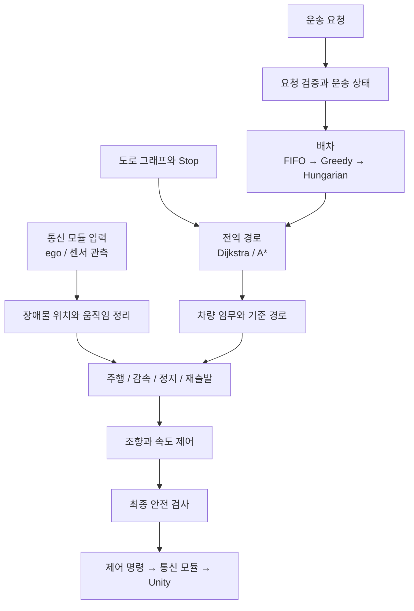
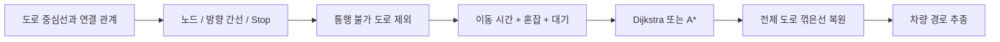
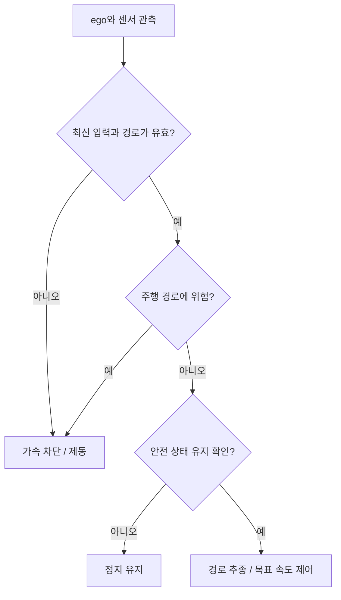

# 이상엽

- 담당: 배차 / 전역 경로 / 장애물 대응과 회피 / 서버 판단과 제어
- 기간: 2026년 10월 12~18일
- 기준: main 0.2.1.1
- 문서 사용: 본문만으로 구조와 구현 순서 확인 / 별도 예제 파일은 추가 검증용
- 첫 주 목표: FIFO 요청 처리 / Dijkstra와 A* / 저속 경로 추종 / 장애물 정지와 재출발

## 1. 시스템 구성



- 구현 범위: 요청과 운송 상태 / 배차 / 경로 / 장애물 대응 / 제어
- 통신 협의(이태호): 입력 데이터와 서비스 응답 형식
- 차량 협의(최장현): 제어 단위와 제원 / 센서 설정 / 제동 측정값
- 개발 방식: 함수 단위 검증 후 통신 모듈 연동
- 장애물 회피는 단계적으로 구현
  - 첫 주: 감속 / 정지 / 재출발
  - 둘째 주: 지속 차단 시 전역 우회
  - 후속: RRT 기반 지역 회피와 주행 가능성 검증
- 장애물을 피하는 새 경로가 없으면 정지 유지

### 서버 내부 구조

| 모듈 | 책임 | 주요 클래스 |
|---|---|---|
| `application` | 요청 / 차량 임무 / 운송 상태 | `ServiceFacade`, `MissionService`, `ArrivalGate` |
| `dispatch` | 수행 가능 차량 선택 | `FeasibilityFilter`, `FifoDispatch` |
| `maps` | 도로 그래프와 Stop 읽기 | `GraphReader` |
| `planning` | 경로 계산과 비용 | `CostSnapshot`, `DijkstraPlanner`, `AStarPlanner` |
| `control` | 관측 처리 / 행동 / 제어 | `ObservationProcessor`, `BehaviorFSM`, `RouteFollower`, `SpeedController` |
| `control` | 안전 제한과 재출발 | `SafetyGate`, `RestartGate`, `ControlStep` |

- 기준 경로: `backend/src/campus_sim/`
- `transport`와 Unity 통신 코드는 이태호 담당
- 최초 구현은 차량 1대 / 개발용 거점 6개
- 배차 비교용 합성 입력은 여러 차량 사용 가능 / 실제 다차량 운행과 구분

## 2. 서버 인터페이스

| 함수 | 입력 | 반환 |
|---|---|---|
| `ServiceFacade.submit_request(request, principal)` | 운송 요청과 확인된 사용자 | 요청 처리 결과 |
| `ServiceFacade.get_state(role, principal)` | 역할과 사용자 | 역할별 서비스 상태 |
| `MissionService.step(ego, now_s)` | 자기 차량 상태 | 임무 상태 변경 |
| `GlobalPlanner.search(graph, start, goal, costs)` | 지도와 출발/목적지 | `RoutePlan` 또는 `NoPath` |
| `ControlStep.step(frame, mission, route, limits, dt)` | 관측과 임무 / 제원 | `ControlCommand` |

- 서버 모듈: 요청 처리와 결과 생성 / 통신 모듈: JSON 변환과 전송
- 요청 중복 처리는 `command_id` 기준 / 같은 사용자와 내용은 기존 결과 반환
- 사용자 권한과 차량 수행 조건을 서비스에서도 확인
- RoutePlan: 지도 버전 / 비용 버전 / 도로 ID / 전체 꺾은선 / 비용
- 미계산 ETA는 null / 합성 시간과 실제 예상 시간 구분

### 협업 입력과 전달 결과

| 항목 | 받을 내용 | 전달할 내용 | 상대 기능이 없을 때 |
|---|---|---|---|
| 통신 / 이태호 | 인증된 요청 / ego / 센서 관측 / 적용 결과 | 요청 응답 / 운행 상태 / 제어 명령 | 서비스와 제어 함수를 직접 호출 |
| 차량 / 최장현 | 차량 제원 / 센서 설정 / 제동 기록 | 조향/가속/제동 명령 / 사용 관측 / 판단 사유 | 임시 제원과 관측 파일 사용 |
| 화면 / 클라이언트 | 출발/도착 선택 / 요청 ID | 배차 차량 / Stop / 상태 / ETA / 안내 사유 | 고정 요청으로 서비스 실행 |

- frame: 같은 차량의 ego와 센서 관측 / 관측 시각과 pose 참조 불일치 시 정지
- Mission: 차량 ID / 요청 ID / 임무 단계 / 목표 Stop / route_id
- RoutePlan: route_id / map_version / cost_snapshot_id / edge_ids / 전체 polyline / cost_s
- 지도 최소 구성: 노드 위치 / 방향 간선 `(u,v,key)` / 도로 꺾은선 / 길이와 속도 / 통행 제약 / Stop
- 제원 최소 구성: 축간거리 / 최대 조향각 / 속도 상한 / 제동 성능
- 센서 설정: 장착 위치와 방향 / 감지 거리 / 빔 방향 / 스캔 주기 / 설정 버전
- 임시 제원과 지도는 합성값으로 표시 / 차량 측정과 도로 확인 후 교체
- 제어 출력은 `steer_angle_rad`, `throttle_01`, `brake_01` / 가속/제동 비율은 0~1
- Unity에서 조향각과 토크로 변환 / 서버에서 차체 위치를 강제 지정하지 않음

### 공통 데이터 기준

- 신규 runtime 계약: `schema_version = 4` 초안 / 기존 화면 DTO와 fixture는 3 유지
- `project_version`: 실제 빌드의 VERSION 값 / 계약 버전과 별도 관리
- 자기 차량 물리와 센서 생성은 Unity / 배차와 판단은 Python
- 운송 요청은 기존 HTTP API / 차량 상태와 제어 명령은 WebSocket
- 접속 시 `hello` → `welcome`으로 run / 세션 / 역할 / 차량 권한 확정
- 공통 메시지 필드
  - `type`, `schema_version`, `project_version`
  - `run_id`, `message_id`, `seq`, `simulation_tick`, `simulation_time_s`, `payload`
- seq는 run/session/vehicle/type/sensor_id별 증가 / 제어 명령은 `command_id` 중복 검사
- Python 위치: east/north/height ↔ Unity x/z/y / 거리 m / 속도 m/s / 시간 s
- heading: 북쪽 0 / 동쪽 π/2 / 시계 방향 양수 / 조향각 rad
- 센서 로컬 축: right/forward/up / Radar 접근 속도 음수, 이탈 양수
- Unity가 시뮬레이션 시각 생성 / 연결 중단 검사는 별도의 실제 경과 시간 사용

| 데이터 | 반드시 맞출 내용 |
|---|---|
| `ego.state` | vehicle_id / pose_version / position / heading_rad / speed_mps / velocity / last_applied_command_id |
| `sensor.observation` | vehicle_id / sensor_id / sensor_type / sensor_config_version / scan_id / observed_tick / observed_time_s / ego_pose_version / validity / hits |
| LiDAR hit | beam_id / range_m / bearing_rad / local_position |
| Radar hit | LiDAR hit 필드 + radial_relative_speed_mps |
| `control.command` | vehicle_id / command_id / route_id / source_observations / source_pose_version / issued_time_s / valid_until_s / steer_angle_rad / throttle_01 / brake_01 / motion_state / reason_code |
| `control.result` | vehicle_id / command_id / status / applied_tick / rejection_code |

- `source_observations`: `{sensor_id, scan_id, observed_tick}` 배열
- 관측 배열 null은 거부 / 관측 누락에 따른 정지 명령에는 빈 배열 허용
- `VALIDATED`: 입력 확인 / `APPLIED`: 실제 물리 적용 / `REJECTED`: 거부
- `APPLIED`에 적용 tick 기록 / `REJECTED`에 거부 사유 기록
- 타 객체의 실제 ID / 위치 / 전체 속도 / 미래 궤적은 판단 입력에서 제외
- Radar 생성에만 Unity 내부 속도 사용 / 계산된 방사 상대속도만 전송

### 요청과 운행 상태

- 요청 입력: `command_id`, 출발/도착 `landmark_id`, 서비스 종류, 인원/화물량, `service_needs`
- `service_needs`: 계단 없는 접근 필요 여부 / 휠체어 슬롯 수 / 승하차 지원 여부
- 서버에서 실제 pickup/dropoff Stop 결정 / 사용자 식별은 인증된 세션 기준
- 같은 요청 재전송은 동일한 `command_id` 사용 / 새 요청에는 새 ID 발급
- 운송 흐름: 대기 → 배차 → 픽업 정차 → 승차 → 운송 → 하차 → 완료
- 상태는 서버가 결정 / 화면은 수신 상태 표시 / 근접 통과만으로 도착 처리 금지
- 상태 데이터에 필요한 최소 내용: 요청 ID와 상태 / 차량 ID / 승하차 Stop / 운행 상태와 사유 / 갱신 시각 / ETA
- ETA 미계산 시 null / 모바일은 본인 요청만 수신
- 위 상태 항목은 첫날 합의할 초안 / 임시 화면과 서비스도 같은 항목으로 구현

## 3. 핵심 설계

### 지도와 경로 탐색



- Unity 외형 메시를 직접 탐색하지 않고 별도 도로 그래프 사용
- 도로별 폭 / 방향 / 제한속도 / 계단 / 차량 허용 / 검증 상태 저장
- 실제 지도에서 미확인된 도로 제외 / 합성 지도는 별도 표시
- 도로 `(u,v,key)`와 전체 꺾은선 보존
- Stop은 건물 중심이 아닌 정차 가능한 위치에 연결
- 비용: 이동 시간 + 0 이상의 혼잡/구역/대기 비용
- A* 예상 남은 시간: 직선거리/전역 최대속도
- 같은 지도와 비용에서 Dijkstra와 A* 최적 비용 비교

### 장애물 판단과 제어



- LiDAR: 경로 주변 점유 확인
- Radar: 전방 물체의 방사 상대속도 확인 / 접근 음수
- 횡단 물체는 방사 속도가 작아도 위험 가능 / LiDAR와 함께 판단
- 자기 차량 위치는 허용 / 타 객체의 실제 ID나 위치는 판단 입력에서 제외
- 조향: Pure Pursuit / 속도: PI 제어
- 정지 거리: 현재 속도 / 반응 지연 / 측정 감속도 / 여유 거리 반영
- 최종 SafetyGate에서 위험 시 가속 차단과 제동 우선
- 센서가 없을 때 안전 정지 명령 생성 / 정상 주행으로 대체 금지

## 4. 구현 순서

### 12일 / 서비스와 제어 입력 틀

- 서버 인터페이스와 데이터 형식 확정
- 기존 요청 검증 코드 재사용 범위 확인
- `ControlStep`은 첫날 안전 정지만 반환
- `FifoDispatch`는 예제의 요청 생성 순서와 차량 ID 순서로 배정
- 미구현한 경로와 제어 기능은 미완료 상태 반환
- 확인
  - [ ] 함수 호출만으로 요청과 제어 실행
  - [ ] 본문 FIFO 최소 사례의 기대 배정 일치 / 이후 09_fifo_case 확인
  - [ ] 센서 누락 시 가속 명령 없음

### 13일 / 지도와 임무 데이터

- 거점 6개 / 갈림길 / 우회 구간을 가진 합성 그래프 작성
- 노드 / 방향 간선 / 도로 꺾은선 / Stop 형식 고정
- 실제 시험 구간은 별도로 확인 후 같은 형식으로 입력
- 차량 임무: 픽업 이동 → 승차 → 목적지 이동 → 하차
- 차량 제원은 임시 설정으로 시작 / 차량 측정값으로 교체 가능한 설정 구조 적용
- 확인
  - [ ] 합성값과 실제 확인값 구분
  - [ ] 지도 버전과 제원 설정 기록
  - [ ] 같은 그래프로 경로 독립 테스트 가능

### 14일 / 명령 생성과 상태 처리

- `MissionService`와 `ServiceFacade.get_state` 구현
- 시험용 차량 위치로 픽업 이동 상태 입력
- `command_id`, 발행 시각, 만료 시각, 사용 관측 참조 기록
- 시험 구동 명령은 TEST_ONLY에서만 생성
- 확인
  - [ ] 통신 모듈에서 서비스 함수를 호출해 결과 수신
  - [ ] 오래된 입력으로 주행 재개 없음
  - [ ] 서버 명령과 Unity 적용 결과 연결 가능

### 15일 / Dijkstra와 경로 추종

- 통행 불가 도로를 먼저 제외
- 비용을 고정한 뒤 heap 기반 Dijkstra 구현
- 도로 부모 정보를 따라 전체 경로 복원
- 직선과 완만한 곡선에서 Pure Pursuit 조향 구현
- 센서 점을 차량/지도 좌표로 변환해 경로 주변 장애물 정리
- 확인
  - [ ] 일방통행 / 평행 도로 / 도달 불가 / 출발=목적 처리
  - [ ] 경로 비용과 탐색 노드 수 기록
  - [ ] 조향 방향과 최대 조향각 확인

### 16일 / A*와 안전 제동

- 같은 그래프에 A* 추가 / Dijkstra와 비용 비교
- FIFO 배차에 차량 능력 / 접근성 / 경로 / 배터리 조건 적용
- PI 속도 제어와 행동 상태 연결
- 위험 관측 / 관측 만료 / 경로 오류에서 정지 명령 생성
- 확인
  - [ ] A*와 Dijkstra 최적 비용 일치
  - [ ] 운송 불가 차량 배차 방지
  - [ ] 정적 / 접근 / 횡단 장애물에서 가속 차단
  - [ ] 실제 센서 연결 시 저속 정지 확인

### 17일 / 운송 완료와 재출발

- 도착 조건: Stop 거리 / 속도 / 정지 유지 시간
- 승하차 시간 완료 후 다음 상태로 전환
- 같은 요청 재전송 시 중복 임무 생성 방지
- 탑승 후 취소는 안전 정차와 운영 처리로 전환 / 임의 재배차 금지
- 장애물 제거 후 새 관측에서 안전 상태가 유지된 뒤 출발
- 실제 정지 거리로 감속도와 여유 거리 보정
- 확인
  - [ ] 거점 통과만으로 운송 완료 처리 금지
  - [ ] 장애물 제거 후 안전 상태 유지 시간 확인
  - [ ] 실제 제동 미측정 항목은 별도 표시

### 18일 / 전체 운송 확인

- 정상 운송과 장애물 정지/재출발 각각 3회 실행
- 요청 → 배차 → 경로 → 명령 → 적용 → 완료 기록 연결
- 독립 테스트 결과와 통합 테스트 결과 분리
- 둘째 주 작업 정리
  - 지속 차단과 혼잡에 따른 전역 우회
  - 비룡플라자 앞 우회 정책
  - FIFO 안정화 후 Greedy / 이후 Hungarian 비교
  - 지역 회피는 정지와 우회 검증 후 확대
- 혼잡 시간 가정: 09:00 / 10:30 / 12:00 / 13:30 / 15:00 전후
- 사용자 관찰에 따른 가정과 실측 통계 구분
- 확인
  - [ ] 실행 설정 / 지도 버전 / seed / 결과와 실패 원인 기록
  - [ ] 25일 MVP 확정 / 26~27일 점검 / 28일 발표 일정 유지

## 5. 독립 테스트

- `SyntheticMapProvider`: 고정 시험 지도
- `FakeMissionSource`: 차량 임무와 기준 경로
- `ReplayObservationSource`: 정적 / 접근 / 횡단 / 가림 / 누락 관측
- `KinematicTestPlant`: 조향과 속도 입력에 반응하는 간단한 이동 모델
- 네트워크 없이 `submit_request`, `search`, `step` 직접 호출
- 같은 입력에서 같은 결과가 나오는지 반복 확인
- 간단한 이동 모델은 제어 로직 시험용 / 실제 WheelCollider 제동 검증과 구분
- 센서 JSON의 고정 시각은 파일 시험용 / 반복 재생 시 시각과 참조 갱신
- 실제 모듈 연동 후 동일 사례 재검증 / 독립 테스트는 회귀 검증용으로 유지

### 파일 없이 시작하는 최소 입력

- 공통 envelope의 payload에 아래 시험 명령 사용
- 센서가 없는 초기 상태를 가정한 정지 명령 / 정상 주행 입력으로 사용 금지
- run_id는 현재 실행 ID / seq는 새 번호 / 시뮬레이션 시각은 4.0초로 설정

```json
{
  "vehicle_id": "V01",
  "command_id": "stop-1",
  "route_id": null,
  "source_observations": [],
  "source_pose_version": null,
  "issued_time_s": 4.0,
  "valid_until_s": 4.2,
  "steer_angle_rad": 0.0,
  "throttle_01": 0.0,
  "brake_01": 1.0,
  "motion_state": "EMERGENCY_STOP",
  "reason_code": "MISSING_OBSERVATION"
}
```

- 시각과 reason_code는 시험용 초안 / 실제 실행 시 코드 목록과 함께 확정
- 최초 판독 결과: VALIDATED / applied_tick은 null
- 실제 바퀴 적용 후: APPLIED / 적용한 tick 기록
- 만료 시각 이후 입력 / 이전 run / 중복 command_id는 새 구동 명령으로 적용 금지
- 잘못된 형식의 입력 거부와 차량 자체 정지는 별도 확인
- 정상 센서 입력: 차량 V01 / pose_version 200 / 같은 시각의 LiDAR와 Radar 관측
- 기본 장애물 사례: 전방 8m / Radar 방사 상대속도 -2m/s
- 위 센서값은 구조 확인용 합성 입력 / 안전한 정지 거리 보장값으로 사용 금지
- `examples`는 확장 사례 모음 / 첫 구현은 본문 항목과 시험 입력으로 시작 가능

- FIFO 최소 사례: 요청 R01 → R02 / 유휴 차량 V01 → V02 / 모든 조합 수행 가능
- 기대 배정: R01→V01 / R02→V02 / 한 차량에 중복 배정 없음
- 수행 불가 조합 제외 후 남는 차량이 없으면 요청 대기
